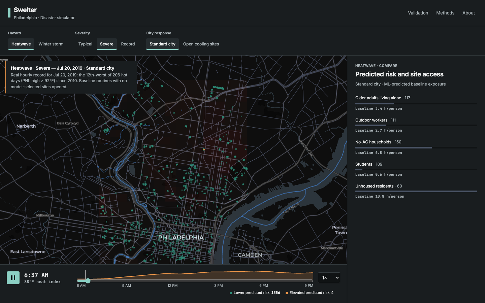
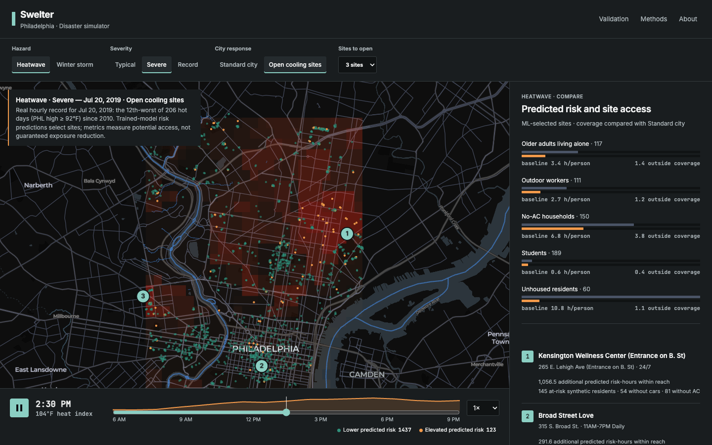
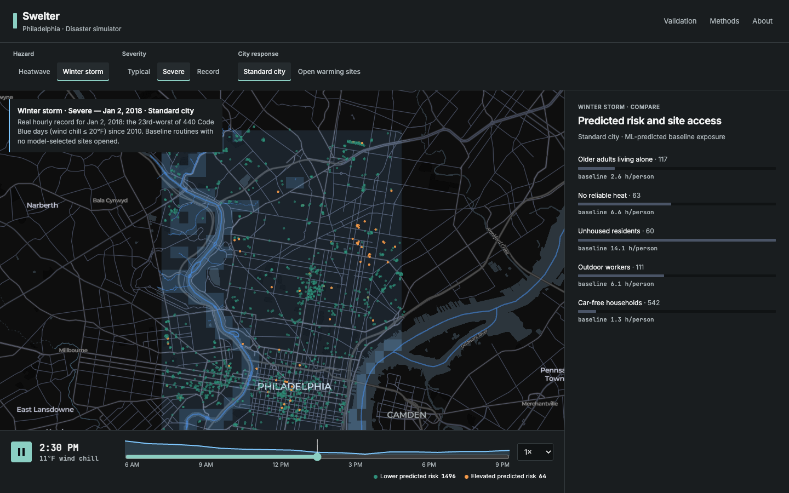
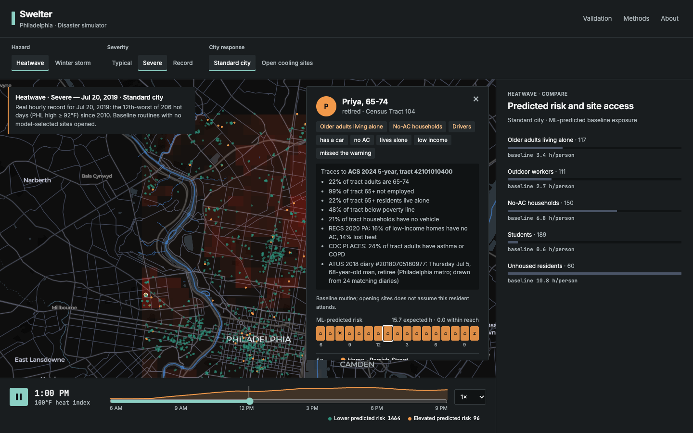
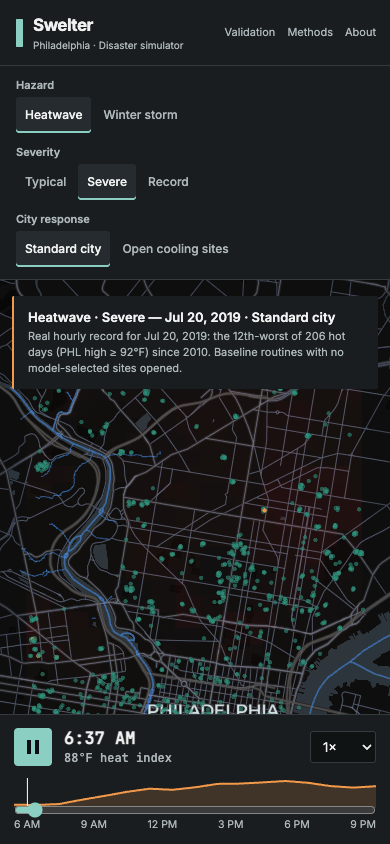
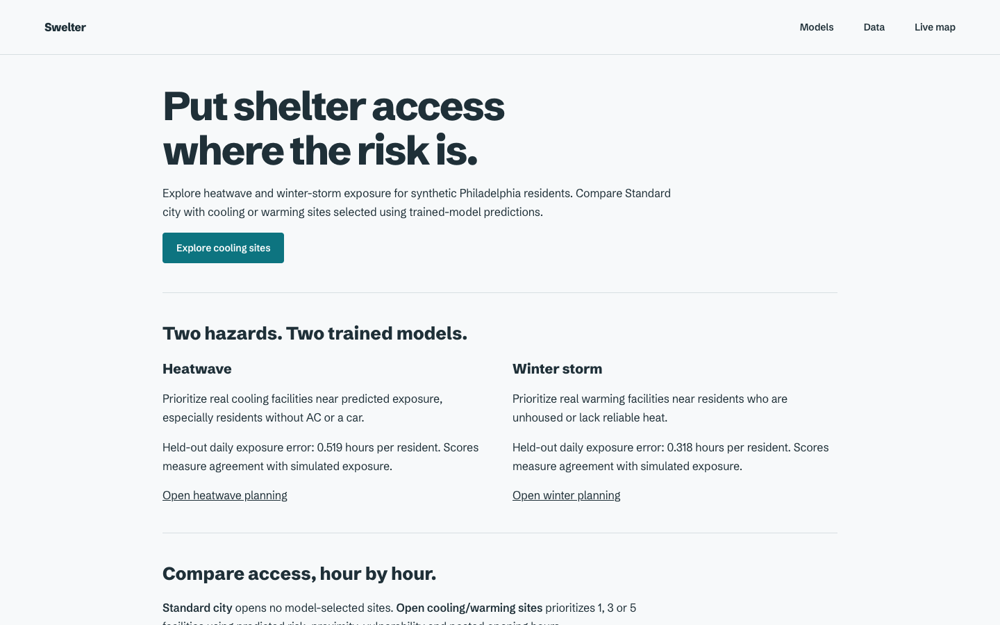

# 01 · UI audit (before the redesign)

Branch `ui-redesign`, Oct 25 2026, ~9 AM. Commit `95d3a97` as shipped on `main`.

How this was made:

- **Screenshots:** `playwright-cli` and Node are not installed on this Mac, so the screenshots come from Python
  Playwright driving Chrome (`uv run --with playwright`), 1440×900 and 390×844, reduced motion off. Files are in
  `docs/ui/img/before/` (32 PNGs: each hazard × response, first load, mid-playback, inspector, both modals, About).
- **Taste skill:** its scripts need Node 22; they run under Deno (`deno run -A …/lint.mjs`, `inspect.mjs`).
  The simulator is an *app screen* (inspected with `--app`); About is a *page*. Raw reports:
  `.taste-skill/before/sim/report.json`, `.taste-skill/before/about/report.json`.
- **Web Interface Guidelines:** fetched fresh from vercel-labs/web-interface-guidelines and applied to
  `app/index.html`, `main.js`, `shelters.js`, `style.css`, `about.*`.

Two facts the brief doesn't reflect yet. Both affect the redesign:

1. **Scope is now 2 hazards × 2 responses, not 4 × 4.** The live app shows Heatwave and Winter storm only, each
   with Standard city or Open cooling/warming sites (+ a 1/3/5 site budget). Smoke and flood runs are still on disk
   but not reachable from the UI (AGENTS.md, "Active scope update").
2. **"Held-out MAE 0.6 pp" is not in the app any more.** The Validation modal now shows the trained shelter models
   (heat 0.519 h/person daily MAE, cold 0.318 h, plus the cold-day failure). The 0.6 pp mobility fit is still true
   and is in README, but no screen shows it. For the landing stat we need to pick one, or show both with their
   own labels.

---

## Top 10, ranked by what a judge notices first

### 1. The first screen says "nothing is happening"


The demo opens at 6:00 AM on Standard city. At that moment 1,556 dots are green ("lower predicted risk") and 4
are orange. The heat overlay is invisible until about 11 AM, and no sites are open. For the first ~20 seconds of
playback a judge sees a calm green map, which is the opposite of the pitch. Compare with 2:30 PM on the same
day, which tells the story by itself:



**Fix:** open on the dangerous hours: start the replay at about 11 AM, or open paused at the day's peak hour
with "Play the day" as the main action. Make elevated-risk dots the brightest thing on the map and dim the
lower-risk ones.

### 2. No headline and no finding
Nothing on the first screen says what you're looking at or what the answer is. The panel title "Predicted risk
and site access" is generic. The scenario badge is a three-line 12px paragraph. The single most important
number (for example, unhoused residents face 10.8 predicted danger hours on Jul 20 2019, and 3 sites bring
X% of all risk-hours within reach) isn't stated anywhere. A judge has to read bars to work it out.
**Fix:** a one-line finding, computed from `planningSummary()`, set large over the map or at the top of the
panel, next to the response toggle that changes it.

### 3. Chrome takes more than half the screen
At 1440×900 the header and controls take 165px, the timebar 115px and the panel 410px. The map gets about 45%
of the screen. On a phone the header and the three control rows take 280px before the map starts
(`sim-first-load-mobile.png`), and the compare panel is below the fold.
**Fix:** one compact control bar (about 56px) with the scenario as a sentence ("Heatwave · Jul 20 2019 ·
Standard city"), a slimmer timebar laid over the map, and a narrower panel. On a phone, use a bottom sheet.

### 4. The heat overlay reads as a rendering bug


The hazard grid is a hard-edged rectangle of blocky cells that stops at the study-area bbox, with nothing
explaining it. The cold version is a flat blue slab over the whole area. It has no legend, so its colour
carries no meaning.
**Fix:** fade the grid edge (alpha falls off over the outer cells), cap the alpha lower, and add a small
continuous legend ("Heat index offset, city HEI") beside the clock readout.

### 5. Colour semantics fight each other
"Lower predicted risk" dots are green-teal, which reads as safe, and that's the same family as the UI accent
(`#8bcfc3`), the play button, the site markers and the selected-tab underline. The map's main signal (elevated
risk) is a small orange dot. The legend is 11px in the bottom-right corner.
**Fix:** neutral grey or white for lower risk and one hot colour for elevated. Sites get a distinct mark
(ring + number). The UI accent is used only on the action.

### 6. The compare panel looks like a dashboard template
5px hairline bars, 11px monospace captions ("baseline 3.4 h/person"), no axis or scale, and on Standard city a
column of grey bars with no colour on the data. The "outside coverage" bar sits under the baseline bar at the
same weight, so the comparison doesn't pop.
**Fix:** one bar per group showing total risk-hours, with the within-reach part as a filled segment of the
same bar. Numbers in tabular lining figures at a readable size, and groups sorted by risk.

### 7. The resident inspector buries the day and lost its "why"


The card covers a third of the map (all of the phone screen, `sim-inspector-mobile.png`). It opens with nine
chips and an eight-bullet data trace. The 17-hour timeline, the most visual part, sits below the fold, and its
cells use glyphs (⌂ ☀ ⚒ ✚) that are nearly all "⌂". The **live "why" explanation was removed** in the Oct 25
"Resident UI cleanup", but CLAUDE.md and the demo script both lead with it.
**Fix:** order it as identity line → day timeline → hour-by-hour → data trace (collapsed). **Decision for you:**
should the "why" button come back? `server.py` `/api/why` still works.

### 8. Default-kit typography and no product face
Inter + JetBrains Mono (lint FAIL: monospace for numbers), six sizes from 10 to 19px, the largest type on the
screen is the 19px wordmark, the logo is a 7px teal bar, and 10px text appears four times (inspector
`tiny-text` FAIL). It reads as a well-applied kit, not Swelter.
**Fix:** one characterful grotesk with tabular figures, a real mark, 11px minimum, and the clock and finding
as the big numbers.

### 9. The phone layout is the desktop squeezed


The controls stack three rows high, the map gets about half the screen, the compare panel is below the fold, the
inspector covers everything, and text sits 14px from the edge (inspector `edge-text`).
**Fix:** map full-height, scenario in one row of compact selects, and panel and inspector as a draggable bottom
sheet.

### 10. The About page lost its design and sells nothing


It's a plain document: no pictures (`few-pictures` FAIL), even though `app/img/heat-day-wide.mp4` and five real
screenshots exist. It has hairline dividers, off-centre margins (64px left vs 166px right), 2 of 3 screens nearly
empty, no motion, and a 58px headline. It scores 6 FAIL in the inspector. AGENTS.md says it passed with 0 FAIL
before the minimal-UI pass. This becomes the new landing page.

---

## Polish (after the first 10 seconds)

Web Interface Guidelines, terse `file:line`:

### app/index.html
- `app/index.html:11` fonts load after the app CSS; no `preconnect` to `fonts.gstatic.com` with `crossorigin`
- `app/index.html:39` `#iv-badge` changes on every switch without `aria-live="polite"`, so scenario changes aren't announced
- `app/index.html:40` tooltip is hover-only, so touch users get nothing until they tap (which opens the inspector)
- `app/index.html:42` inspector `<aside>` has no accessible name, focus doesn't move into it on open or return on close
- `app/index.html:43` close button label "Close" → "Close resident details"
- `app/index.html:55` time range has no `aria-valuetext`, so it reads "14.5" instead of "2:30 PM"
- `app/index.html:86` `<dialog aria-label="Simulation information">` → `aria-labelledby` the modal's `h2`
- `app/index.html:14` no skip link; full-bleed layout ignores `env(safe-area-inset-*)`
- `app/index.html:49-50` `.clock`/`.readout` update every frame; fine visually but don't make them live regions

### app/main.js
- `app/main.js:260` residents are only selectable by pointer on the canvas: no keyboard path to inspect a resident (add "Next elevated resident" / list in panel)
- `app/main.js:172` `div role="button"` bar rows → native `<button>`
- `app/main.js:323` timeline cell detail lives only in `title`, so keyboard and touch can't reach it
- `app/main.js:377` playback autoplays even under `prefers-reduced-motion`; start paused there
- `app/main.js:383` no loading state: map and panel are blank while meta + model JSON (~MBs) load
- `app/main.js:118` URL doesn't reflect state: switching hazard/response doesn't update `?hazard=…&iv=…`, so a judge can't share what they see
- `app/main.js:20` hard-coded time format (`Intl.DateTimeFormat` optional for a single-locale demo)
- `app/main.js:339` avatar hue list includes `#a78bfa` (violet)

### app/style.css
- `app/style.css:93,153,182,219` text at 9.5–10.5px (ticks, timeline hours, attribution, eyebrow)
- `app/style.css:112` `transition: width`: animate `transform: scaleX` instead
- `app/style.css:199-306` a second full layer of overrides on top of the first (two topbar, panel and inspector definitions); hard to restyle safely and will be consolidated
- `app/style.css:107` `.bar-label` needs `min-width:0` + wrapping for long group names
- no `touch-action: manipulation` on controls

### app/about.html
- `app/about.html:3` no `theme-color`; no skip link; no `preconnect`
- `app/about.html:14` paragraphs run to 92 characters per line

### app/shelters.js
- ✓ pass (buttons, `aria-pressed`, `aria-live` on the list)

## Nice to have
- Overlay legend for heat-index offset / wind chill.
- Clicking a sorted group should also show "N residents highlighted" on the map.
- Keyboard shortcuts hint (Space = play) somewhere visible.
- Pre-warm CARTO tiles; on a flaky venue network the map falls back to a flat background.

---

## Taste-skill critique

### Simulator: `inspect.mjs --app`: 3 FAIL, 3 WARN
FAIL `button-fx` (inset shadow on the selected segment), `font-not-dealt` (Inter/JetBrains Mono),
`tiny-text` (10px). WARN `micro-label` ("HEATWAVE · COMPARE" eyebrow), `font-count` (3), `edge-text` (phone).
Lint: 36 FAIL / 22 WARN, mostly monospace, hairline borders, 6 backdrop blurs, emoji glyphs, eyebrow,
gradient on the old logo and why-button, violet avatar.

```
ROUND 0 (before)
Seen in one second: a dark city map full of green dots. No word or number reads first.
Idea (one sentence): none visible: a real day's heat replayed on real residents is the idea, but the first
  screen shows 6 AM calm.
Live thing: scrubbing the day / switching response: real, but the default state hides it.
Layout words: header=bar / controls=row of tabs / map=full / panel=bars list / timebar=strip
Scores: design 5.5 · usability 6.5 · creativity 6 · content 7 → overall 6.1
Caps applied: monospace labels + eyebrow → ≤ 6.5; no finding on first screen (app rule) noted.
Top three problems:
1. Opens on the calmest moment of the day (sim-first-load-desktop.png). Open on the danger hours.
2. No headline figure or finding; the largest type is the 19px wordmark (desktop-fold.jpg). State the finding.
3. Kit look: Inter + mono, hairline bars, teal everywhere. One face, tabular figures, colour only on risk.
```

### About: `inspect.mjs`: 6 FAIL, 2 WARN
FAIL `hairline`, `few-pictures` (0), `focal-point` (largest type 4vw), `off-centre`, `still-page`,
`empty-screens` (2 of 3). WARN `no-footage`, `measure`.

```
ROUND 0 (before)
Seen in one second: a headline on a pale page.
Idea: none on the page; it is a text explainer.
Live thing: the hazard form, which just links to the map.
Layout words: hero=statement / models=two columns / compare=text / data=text / explore=form
Scores: design 4.5 · usability 6.5 · creativity 4 · content 6.5 → overall 5.2
Caps applied: FAIL present → ≤ 6.0; fewer than 4 pictures → design ≤ 6.5; 2 empty screens → design ≤ 6.5.
Top three problems:
1. No picture of the product although the clip and screenshots exist (about-desktop.png).
2. Off-centre frame and empty screens (desktop-page-01.jpg).
3. Hairline section dividers and a 58px headline that does not lead.
```

### AI-slop tells found (from `references/tells.md`)
| Tell | Where |
|---|---|
| Monospace as the "technical" voice for numbers | clock, readout, bar captions, legend counts, timeline hours |
| Eyebrow label above the heading | "HEATWAVE · COMPARE" |
| Hairline dividers and 1px outlined boxes everywhere | topbar, panel, timebar, steps list, About sections |
| Near-black ground + one teal accent on everything | accent on play, tabs, sites, safe dots |
| Emoji/glyphs as icons | timeline cells ⌂ ☀ ⚒ ✚ $ |
| Glass (backdrop blur) | 6 rules left in CSS (overridden, but still shipped) |
| Default typeface | Inter |
| Gradient | old logo + why-button rules still in CSS |

Not present (good): no gradient hero, no icon cards, no pill badges, no fake KPI tiles (removed), no
invented numbers. Every figure comes from the data.

---

## `.taste-skill/direction.json`: keep or replace?

**Replace it.** It was dealt for the About page on Oct 24: "sentence-as-layout", a light frost-and-slate palette
(`#f7f9fa` / `#1f3038` / teal `#0d7480`), Schibsted Grotesk 800, and a hero that puts an **Unsplash city
photograph** inside the headline. Three reasons it doesn't fit the new site:

1. **It splits the product in two.** A pale editorial landing page next to a dark map simulator looks like two
   products. The new site map (landing → simulator → downloads → about) needs one dark system shared by every page.
2. **Its imagery is stock.** The brief says the hero should use the real simulation (the replay or
   `heat-day-wide.mp4`), not stock city photos. The direction's core device is a stock photo in the headline.
3. **The current About page no longer follows it anyway** (6 FAIL), so there's nothing to preserve.

What's worth keeping: **Schibsted Grotesk** is a good, slightly warm grotesk with tabular figures and could carry
over as the type. The "sentence with the product inside it" idea also fits well if the slot holds the live map
replay instead of a photo. I'll deal fresh directions (page and `--app`) in Phase 3 and present two.
