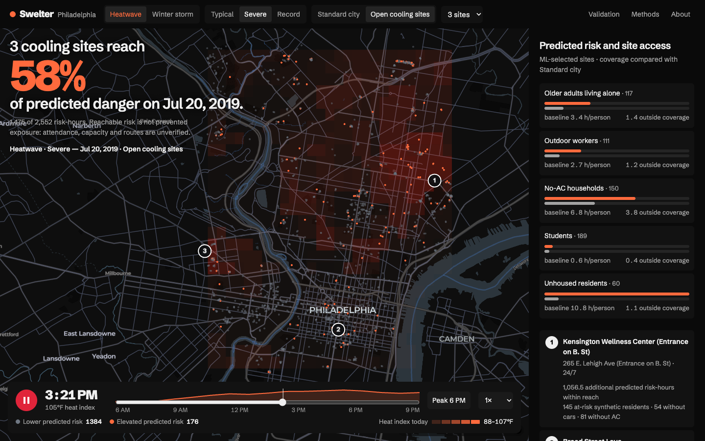
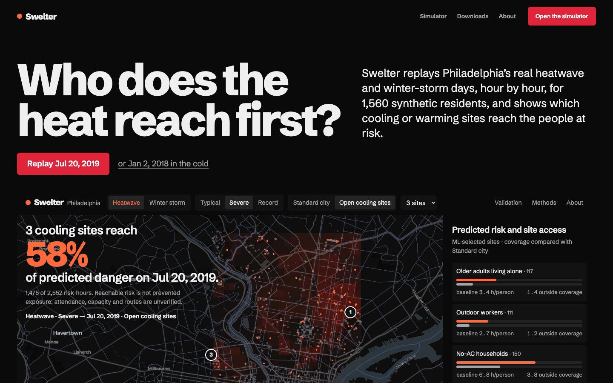
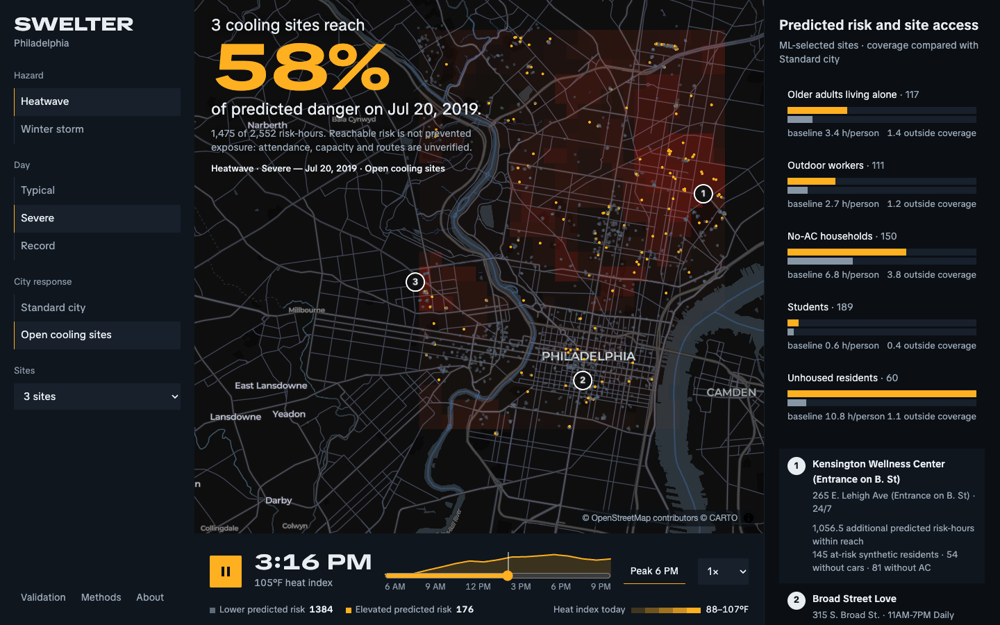
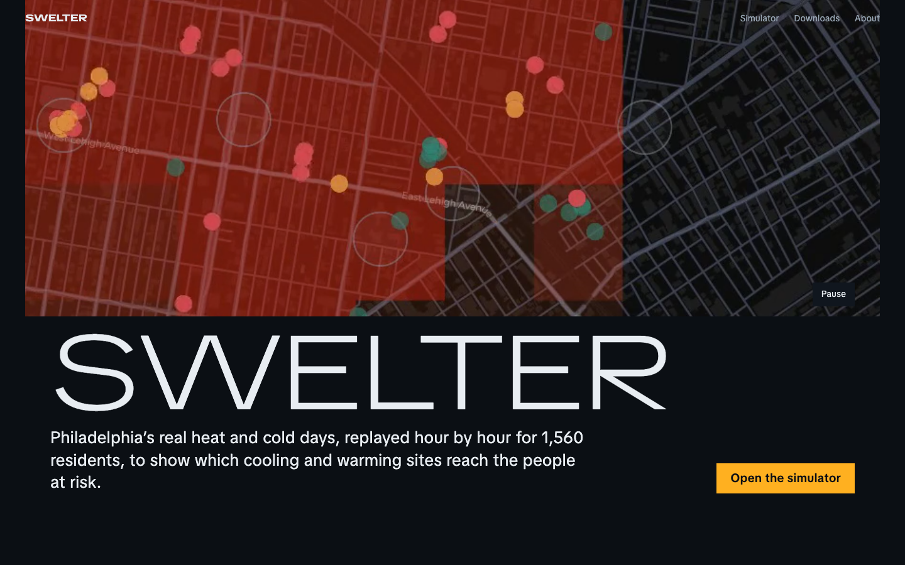

# 02b · Two directions (Phase 3 previews)

Open http://localhost:8000/_preview/ (index of all previews). The simulator previews run on **live data**: they load
`_preview/sim.js` (a copy of `main.js` with the preview changes), the real `shelters.js`, and a small `hud.js`.
Element IDs and data contracts are unchanged, so porting the winner into `index.html`/`main.js` is mostly CSS
plus the diff in `sim.js`.

Screenshots: `docs/ui/img/preview/` (desktop 1440×900, mobile 390×844).

**image-to-code wasn't used.** It needs an image-generation tool, and none is available in this session (AGENTS.md
noted the same). The HTML previews are the mockups, built on the real map and data instead.

## Shared across both directions (the fixes from the audit)
- **Opens on the dangerous hours** (11 AM, or `?t=`) instead of 6 AM calm, and starts paused under Reduce Motion.
- **A finding in large type over the map**, computed live from `planningSummary()`:
  Standard city → "Unhoused residents face **10.8 h** of predicted danger each on Jul 20, 2019." with a one-click
  "Open 3 cooling sites". Open sites → "3 cooling sites reach **58%** of predicted danger on Jul 20, 2019." with
  "Reachable risk is not prevented exposure: attendance, capacity and routes are unverified." right under the figure.
- **Colour on risk only:** lower-risk dots are quiet grey, elevated risk is the hazard's colour, and sites are a white
  ring with a number. The basemap roads and water are dimmer.
- **Timebar:** a big clock, the heat-intensity spark kept, a "Peak 6 PM" jump, live counts, and a stepped hazard ramp
  with today's range (88–107°F).
- **Inspector:** identity → big danger-hours figure → 17-hour strip → **live "Why did Priya spend the day this way?"**
  (calls `/api/why`, which says whether it's live Claude or the offline reason-code explanation) → chips →
  hour by hour (collapsed) → data trace (collapsed).
- One typeface, no monospace, nothing under 12px, skip link, and `aria-live` on the scenario line.

## Direction A · "Instrument"
*Taste skill:* page "The product performs" (seed 899746653), app style true-black flat. *Reference:* Linear's
surface ladder.
- Black `#0a0a0a` with three lighter steps, ink `#efefef`. Crimson `#e0243a` only on Play, the CTA and "Why".
  Heat data is `#ff6a3d`, cold data `#9fd8ff`.
- **Schibsted Grotesk** 800 for figures, 400–600 for UI.
- Simulator: a single-row bar on top, a full-bleed map with the finding top-left, a floating rounded timebar, and a
  quiet results column on the right.
- Landing: a big two-line question ("Who does the heat reach first?"), then **the simulator itself running in the
  hero** (an iframe, fully interactive), then the real day as 17 hourly bars, four tone-step fields for the inputs,
  a ledger of 0.519 h / 0.6 pp / "1 fail", the honesty note, the CTA, and a cropped wordmark footer.

## Direction B · "Night shift"
*Taste skill:* page "The dark room" (seed 292592633; **palette redrawn** from forest/lime to blue-black/amber
because green reads as "safe" on a risk map), app style data-terminal. *Reference:* Runway (footage as interface)
and Linear.
- Blue-black `#0b0f14`, amber `#ffb020` as both accent and heat data, ice `#8fd3ff` for cold. Square corners.
  Every selection is the same 1px amber line.
- **TikTok Sans**: wide caps for the brand and big figures, normal width for reading.
- Simulator: **a left instrument rail** with the scenario as vertical lists, the map in the middle, the timebar
  docked full-width under the map like a chart strip, and the results column right. The inspector is a
  full-height sheet.
- Landing: **the replay clip full-bleed** with a pause control, then "SWELTER" in light wide caps, the lead and a
  CTA. Then a sideways row of real screens, call-and-response "How a day is built", a giant amber 0.519 h with
  0.6 pp under it, the honesty note, and a quiet closing sentence.

## Trade-offs
| | A · Instrument | B · Night shift |
|---|---|---|
| Map share at 1440 | ~72% (bar on top, panel right) | ~58% (rail left + panel right) |
| First 10 seconds | Finding over the map, product shown working on the landing | Strong instrument feel, scenario always visible |
| Risk | Floating timebar covers the map's foot | Two side columns squeeze the map; amber for both UI and heat |
| Landing hero | Live simulator (heavier, but always current) | Clip (light, cinematic) **but the existing clip shows the old UI colours**; it must be re-recorded after the restyle |

## My recommendation
**Simulator A + landing A**, borrowing two things from B: the docked hazard ramp styling, and B's sideways row of real
screens for the landing's "what you get" section. A keeps the most map, and its finding reads first. A live product in
the landing hero means nothing needs re-recording before 2 PM.

## Before implementing (whichever wins)
- `/api/why` is asked about the **Standard city** run, because that's the routine the map replays. Its offline text
  uses the planner's rule-based exposure levels, which can differ from the ML risk shown on the card (Priya: "Worst
  hour 18:00 … extreme danger" next to 15.7 predicted hours). Keeping this UI-only, I'd label the answer "explains the
  simulated day (rule-based exposure)". Making them agree would mean changing `server.py`.
- Old screenshots in `app/img/` show the previous UI; I'll regenerate them from the new UI for the landing.
- About page needs: names, roles, photos (4:5), and links for each teammate, plus 1–2 sentences in your words.
- Downloads: "methods note" and "run CSV" don't exist yet and are marked "Not written / Not built yet".
